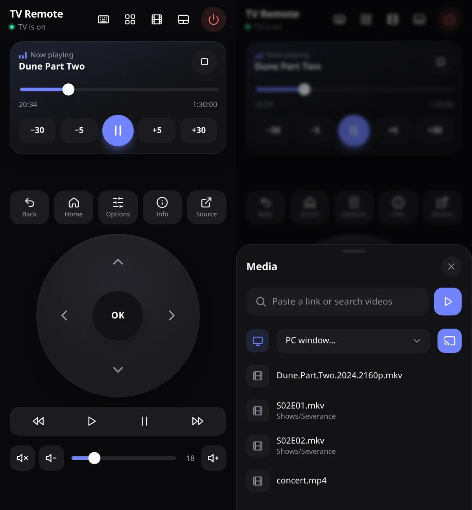
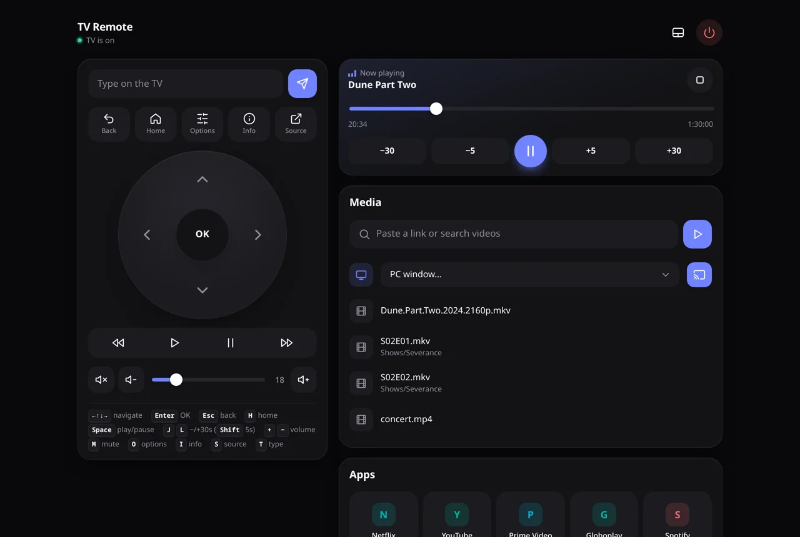

# samsung-tv-remote

Web remote + video caster for old Samsung Tizen TVs. I have a 2016 UN50KU6000, the official apps for it are dead, and casting to it from Linux was a pain, so I wrote this.

One Python script. It runs a small web page on your PC that you open on your phone: remote, volume, installed apps, and a list of videos from `~/Downloads` that play on the TV over DLNA. You can also paste a YouTube/Twitch link, or (on Hyprland) send a PC window to the TV.

Magnet links work too if you have [Stremio](https://www.stremio.com/) installed: its streaming server does the torrent part (it's started in the background, the app doesn't need to be open). And if something is already playing in Stremio, its link shows up on the remote, ready to send to the TV.

<p align="center"></p>
<p align="center"></p>

Should work on other 2016-2017 Samsung Tizen TVs (K/M series). 2018+ models need a token on port 8002, which this doesn't do.

## Setup

Needs [uv](https://github.com/astral-sh/uv) and ffmpeg. The TV and PC have to be on the same network.

```bash
git clone https://github.com/uKeps/samsung-tv-remote.git
ln -s "$PWD/samsung-tv-remote/tv" ~/.local/bin/tv
tv serve   # then open http://<pc-ip>:8765 on your phone
```

The first time, the TV asks whether to allow the connection. Accept it with the real remote.

To keep it running in the background:

```bash
systemctl --user link "$PWD/samsung-tv-remote/tv-remote.service"
systemctl --user enable --now tv-remote
```

### Config (optional)

The TV is found on the network by itself. To turn it on from the remote, put its MAC in `~/.config/tv-remote.env` (you can find it as `wifiMac` at `http://<tv-ip>:8001/api/v2/`):

```bash
TV_MAC=aa:bb:cc:dd:ee:ff
#TV_IP=192.168.1.50     # skips discovery
#VIDEO_DIR=~/Videos     # default ~/Downloads
#WEB_PORT=8765
#TV_MONITOR=HDMI-A-1    # monitor sent to the TV (Hyprland)
```

Power on also needs "Power On with Mobile" turned on in the TV settings.

Sending a PC window needs Hyprland, [gpu-screen-recorder](https://git.dec05eba.com/gpu-screen-recorder/about/) and `pactl`. Without them, that option just doesn't show up.

## CLI

```
tv              interactive remote in the terminal
tv off          any key: tv home, tv vol+ vol+, tv back...
tv on           Wake-on-LAN
tv play <file>  play a file, URL or magnet link
tv yt <url>     open a YouTube video
tv help         everything else
```

## Samsung quirks I ran into

In case you're writing your own thing for these TVs:

- Remote keys go over the WebSocket on `:8001`. The TV drops the first key after connecting and drops keys if you close the socket right away, so keep it open.
- Playback is UPnP AVTransport on `:9197`. MKV has to be announced as `video/x-mkv` (not `x-matroska`) or you get error 714.
- The file has to be served already when you send `SetAVTransportURI`, because the TV probes it immediately (error 716).
- Seeking only works with `DLNA.ORG_OP=01`. Live streams need `DLNA.ORG_OP=00;DLNA.ORG_CI=1` or the TV won't play them.
- If it's stuck mid-transition it refuses everything (701), so send `Stop` first.
- Subtitles go in the DIDL metadata as `sec:CaptionInfoEx`.

## Heads up

The web remote has no login. Anyone on your Wi-Fi can use it, so don't expose port 8765 to the internet. Use Tailscale or similar if you want it outside the house.

Built for my own setup. PRs are welcome, but don't expect support.

MIT
